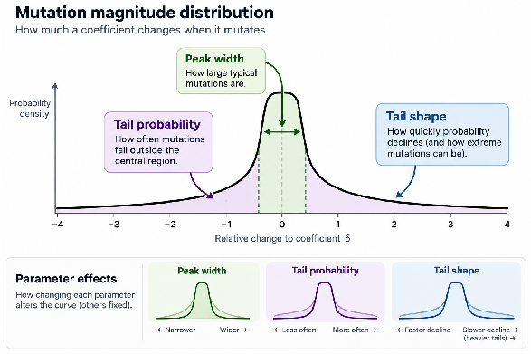

# Petri Dish — Model Specification

> Source: [live Google Docs specification](https://docs.google.com/document/d/12hA4m_78peEYwzJ9oAWqE6TUcwmCMj9ELT81kWjnMMc/edit). This Markdown copy is a snapshot; the Google Doc may be edited independently.

# General settings

### Subject and goals

The Petri dish is a minimal evolutionary simulation. Simple entities interact with local resources and reproduce with inherited variation and deviations. The aim is to observe patterns that emerge.

### Randomness

Design principle: Randomness should not introduce systematic artifacts or unintended correlations into evolution. 

Implementation (provisional): Randomness is organized in two layers: a fresh, randomly generated global seed for each simulation run, and a fresh random seed for each tick. Combine the global and per-tick seeds to generate the random values needed during that tick. Additional salt may be added if necessary.

### Space

The environment is a finite, two-dimensional hexagonal grid. Each hex has six neighbors. Entities are represented as points at hex locations; they have no physical footprint and do not collide. Body size does not occupy additional space. The general shape is also a hexagon.

Model parameters: \[Auto\]

Petri dish radius or side.

# The Entity

## Basics

Entities use two-dimensional geometry: body mass corresponds to circular area, and the boundary available for feeding and excretion corresponds to circumference.

Body mass (M) is the key parameter defining entity size.

Body surface (S) is the circumference of a circle, derived from M.

## Metabolism

The entity eats Food (F) through the surface from the environment. Eating ability per S is constant for all entities, no evolutionary advantage here.

When eaten the food splits into:

- Useful body energy (E). Used for activities.  
- Waste (W). Piles up. Must be excreted.

Food has energy per unit and an energy/waste ratio. We start with a single kind of food.

An entity has useful energy and waste capacity per body mass. All entities have the same.

If either energy or waste capacity is full the entity can’t eat.

Growing and shrinking allow the entity to exchange energy with mass/size.

Dead bodies turn into food according to the body mass and the transformation ratio F/M.

Model parameters: \[Auto\]

Food intake capacity per unit of body surface (F/S).

Energy produced per unit of food (E/F).

Food energy-to-waste ratio (E/W).

Energy storage capacity per unit of body mass (E/M).

Waste storage capacity per unit of body mass (W/M).

Body mass-to-food conversion ratio (F/M).

## Activities

Full list: \[Auto\]

* Persistence. Mandatory. Maintains existence, resisting entropy.  
* Eating. Acquires useful energy, produces waste.  
* Excretion. Removes accumulated waste.  
* Growth. Consumes energy, gains mass.  
* Shrinking. Consumes mass, gains energy and waste.  
* Movement. Changes position.  
* Reproduction. Produces offspring with inherited variations.

### Universal decision function

All five optional activities use the same decision function with only three raw inputs from the entity: body mass (M), stored energy (E), and stored waste (W). There are no direct environmental inputs, additional senses, or memory. Evolution determines how much each input influences each activity.

Pi \= 1 / (1 \+ e−zi)

zi \= bi \+ ∑j (wij · xj)

xj — one of the three raw entity properties: body mass (M), stored energy (E), and stored waste (W). Local food (F), surface (S), normalized values, and derived ratios are not decision inputs.

bi — baseline tendency for activity i. wij — influence of property j on activity i.

Each optional activity has four inherited, independently mutable coefficients: one bias and one weight each for M, E, and W (20 coefficients for five optional activities). Evolution can amplify, reverse, or effectively ignore any input by changing its coefficient.

The probability determines whether an activity is attempted; physical prerequisites, energy costs, and capacities determine whether it succeeds. There is no lower probability threshold: even very unlikely activities may occasionally be selected.

Persistence and eating decisions are fixed and mandatory (Pd \= 1).

### Mutation

Each inherited decision coefficient independently has a chance to mutate (initially 1% per coefficient). Multiple coefficients may mutate during one inheritance.

Mutations usually make small relative changes, but rare mutations can be large enough to reverse a coefficient’s sign. The intended distribution is symmetric around zero: a narrow, high-density central peak, a steep initial drop, and long shoulders that decline progressively more slowly.

The diagram describes the desired behavior, not a required mathematical formula. We may change the implementation while preserving this shape.

#### Suggested function (provisional)

p(δ) \= C / \[1 \+ (\|δ\| / s)k\]α/k,  α \> 1

δ is the relative mutation (w′ \= w(1 \+ δ)). Here s controls peak width, k the sharpness of its edges, α the shoulder falloff, and C normalizes the distribution. Shoulder probability is not independently adjustable in this candidate. The formula may change; the intended shape is what matters.

Model parameters: \[Auto\]

Mutation probability per inherited coefficient (initially 1%).

Peak width — magnitude of common mutations.

Shoulder probability — how often large mutations occur.

Tail shape — how gradually the probability of extreme mutations declines.

Mutate original pattern — OFF: preserve the original coefficients; ON: mutate both resulting patterns independently with the same mutation settings.

Zero coefficients are absorbing under relative mutation, but a nonzero coefficient has zero probability of becoming exactly zero with a continuous mutation distribution (in ideal real-number arithmetic). Near-zero coefficients may become effectively inactive and difficult to restore. This is an accepted feature; no recovery rule or zero threshold is introduced.

### Persistence

Low energy cost per unit of mass. E \= Em × M. Mandatory. Maintains existence, resisting entropy.

Model parameters:

Em — energy cost per unit of body mass M per simulation step.

### Eating

No cost. Consumes F from the environment for each S. Acquires E, produces W. Actual consumption is limited by food availability and remaining storage capacities.

### Excretion

Excretion removes stored W, which disappears from the simulation. It has a low energy cost per W removed. The decision controls whether to attempt excretion, not how much is removed; the actual amount is limited by stored waste, available energy, and excretion capacity.

Model parameters:

Energy cost of excretion per W removed.

Waste excretion throughput per unit of body surface S per simulation step (W/S).

### Growth

Growth is an optional decision independent of shrinking. Each successful attempt increases mass by g × the entity's current M (initially g \= 10%). The entity pays the full energy cost before the increase; if it cannot, the attempt fails without effect. Body surface and energy/waste storage capacities are recalculated after the change.

Model parameters:

g — fraction of current mass gained in one successful growth attempt (initially 10%).

Growth spread σ ≥ 0 — extra energy cost of storing mass. The derived cost per unit of gained mass is Ec \= (F/M) × (E/F) × (1 \+ σ). The spread prevents a net energy gain from repeatedly growing and shrinking; no independent Ec parameter is required.

### Shrinking

Shrinking is an optional decision independent of growth. Each successful attempt converts s × the entity's current M into E and W using the existing F/M, E/F and E/W coefficients, with no separate energy cost. Body surface and energy/waste storage capacities are recalculated from the reduced M. The full attempt is allowed only if M remains at least Mmin and the resulting E and W fit the reduced capacities; otherwise nothing changes.

Model parameters:

Mmin — universal, fixed minimum viable body mass. No activity, including shrinking or reproduction, may leave a living entity below this limit.

s — fraction of current mass converted in one successful shrinking attempt (initially 10%).

### Movement

A successful movement takes the entity exactly one hex to a uniformly random valid neighbor. Directions leading outside the dish are excluded; no navigation or preference is involved. Energy cost is based on the entity's current mass. If the cost cannot be paid, movement fails without effect. Multiple entities may share a hex.

Model parameters:

Energy cost of movement per M per hex.

### Reproduction

Successful reproduction leaves the original entity alive and creates one offspring in the same hex. A fixed fraction of the original body mass is lost during division (initially 10%) and converted into local food using F/M, available next tick. The remaining mass is split equally (initially 50/50), so the parent and offspring each receive 45% of the original mass. Both surfaces are recalculated.

After paying the reproduction energy cost, the remaining stored energy and waste are split equally between parent and offspring. With 'Mutate original pattern' OFF, the parent keeps its coefficients while the offspring independently mutates them; with ON, each pattern mutates independently under the same rules. The offspring acts from the next tick. Successful reproduction terminates the parent's remaining selected activities for this tick. Reproduction succeeds only if both resulting masses are at least Mmin, the full energy cost can be paid, and both entities can store their shares. Otherwise, the attempt fails harmlessly: no mass or energy is spent, no offspring or food is created, and remaining selected activities may proceed. With the initial 10% mass loss and 50/50 split, reproduction requires M ≥ Mmin / 0.45.

Model parameters:

Energy cost of reproduction.

Mass loss on division: initially 10%.

Division ratio of remaining mass and stored resources: initially 50/50 (fixed, not inherited).

### Decision tree

1. Eating (automatic when possible), then persistence (mandatory).  
2. All five optional activities roll independently against probabilities calculated from the same state after feeding and persistence, with no lower cutoff. Growth and shrinking can both be selected in one tick.  
3. Selected activities execute in descending probability order, subject to physical constraints. Ties are randomized. Each action uses the current mass and resources when its turn arrives; growth and shrinking can both execute. A successful reproduction terminates the remaining selected activities, while a failed reproduction does not. Probabilities are recalculated only next tick.

# The Dish

Each hex receives food each tick with the same expected income, but a fresh independent random deviation. There are no permanently favorable hexes; the deviation represents unstable food supply. Uneaten food accumulates, and waste disappears from the simulation.

Model parameters: \[Auto\]

μ — mean food income per hex per tick.

Food-income variability — size of random deviations (distribution to be specified).

# Life cycle

Each tick advances the whole population through the following stages. Newborns act only from the next tick.

### 1\. Sudden death

At the beginning of each tick, every living entity independently faces a sudden-death probability d, regardless of its properties or age. A death is immediate: the entity takes no further actions this tick. Its body becomes food during finalization, available next tick. Newborns enter the population next tick and are eligible for the same check then.

Model parameters: \[Auto\]

d — sudden-death probability per entity per tick (0 ≤ d ≤ 1). Setting d \= 0 disables sudden death.

### 2\. Environment

Every hex independently receives a newly drawn, nonnegative food amount each tick. The expected amount is μ for every hex; deviations have no permanent spatial pattern. The distribution must preserve the stated mean and variability, but its exact form is not yet fixed. Any unconsumed food from earlier ticks remains available.

### 3\. Feeding

Entities sharing a hex feed simultaneously, without processing-order priority. Each entity i can consume at most Dᵢ \= min(kSᵢ, E\_free,i/e, W\_free,i/w) food per tick. Here k is intake per surface per tick (F/S), e is energy gained per food (E/F), and w \= e/(E/W) is waste produced per food.

For H food in the hex, let T \= min(H, ΣDᵢ). Allocate fᵢ \= min(Dᵢ, λSᵢ), choosing λ so that Σfᵢ \= T. Entities that reach their limits stop; the rest share food in proportion to surface. No entity exceeds its surface or storage limits.

Find λ by binary search over \[0, max(Dᵢ/Sᵢ)\] for entities with Sᵢ \> 0: compare Σmin(Dᵢ, λSᵢ) with T and adjust the bounds until numerical precision is reached. Skip the search if T \= 0\. This is one simultaneous allocation, not repeated feeding rounds. Leftover food remains for the next tick.

Example: with 10 food units, equal surfaces, and intake limits of 1 and 10, the entities consume 1 and 9\.

### 4\. Persistence

Each entity pays its mandatory energy cost. If it cannot pay, it dies here; it does not get to attempt optional activities.

### 5\. Decisions

Every survivor calculates probabilities for all five optional activities from the same state snapshot. Each activity is selected by an independent random draw; even very low nonzero probabilities remain possible. Selecting one activity never cancels another.

### 6\. Execution

Each entity attempts selected activities in descending probability order; ties are randomized. Physical constraints determine success. An activity that cannot execute consumes no resources and does not stop the sequence. Successful reproduction is terminating: any remaining selected activities are skipped. Decisions and priorities are not recalculated this tick.

### 7\. Finalization

Register newborns and convert dead bodies and mass lost during reproduction into food using F/M. Newborns and newly released food become available in the next tick.

# Provisional initial configuration (v0.1)

These are adjustable starting values for the first implementation, not additional biological rules or a tuned equilibrium. Seed generation and salting are technical simulation settings, kept separate from these evolutionary parameters.

### Parameter overview

| Parameter | Initial value |
| :---- | :---- |
| **Dish radius** | 5 (91 hexes) |
| **Initial population** | 30, on distinct random hexes |
| **Initial body mass M** | 10 |
| **Minimum mass Mmin** | 0.1 (1% of initial mass; fixed) |
| **Initial energy E** | 40 |
| **Initial waste W** | 0 |
| **Initial food stock** | 0 per hex |
| **Food income** | Mean 3 F per hex per tick |
| **Food variability** | Gamma(shape 4, scale 0.75); SD 1.5 |
| **Food intake per S** | 0.35 F/S/tick |
| **Energy per food (E/F)** | 1 |
| **Energy-to-waste (E/W)** | 2 |
| **Food per mass (F/M)** | 1 |
| **Energy capacity (E/M)** | 8 |
| **Waste capacity (W/M)** | 4 |
| **Persistence cost** | 0.15 E/M/tick |
| **Excretion** | 1.2 W/S/tick; cost 0.05 E/W |
| **Growth / shrinking** | ±10% of current M |
| **Growth spread** | 20% (1.2 E per M grown) |
| **Movement** | 1 random valid hex; cost 0.02 E/M |
| **Reproduction** | 2 E; 10% mass loss; 50/50 split |
| **Sudden death** | 0.2% per entity per tick |
| **Mutation probability** | 1% per inherited coefficient |
| **Mutation curve** | s \= 0.20; k \= 16; α \= 3 |
| **Mutate original pattern** | OFF |
| **Founding coefficients** | b \~ U(−3, −1.5); weights \~ U(−0.01, 0.01) |
| **Initial test duration** | 2,000 ticks |

### Dish and initial population

Hex-grid radius: 5 (91 hexes). Initial population: 30 entities placed on distinct, uniformly sampled hexes; multiple occupancy is allowed later. Initial food stock: 0 in every hex.

Each founder starts with M \= 10, E \= 40 and W \= 0\. Minimum viable mass Mmin \= 1% of initial founder mass \= 0.1, fixed globally for the entire run. Choose mass/area units so S \= 2√(πM).

### Food and metabolism

Food income per hex per tick: independent Gamma(shape \= 4, scale \= 0.75) draws; mean μ \= 3, standard deviation \= 1.5 (50% of the mean). Fresh draws every tick; no persistent favorable hexes.

Food intake per surface per tick (F/S): 0.35. Energy per food (E/F): 1\. Food energy-to-waste ratio (E/W): 2 (therefore 0.5 W per F). Body mass to food (F/M): 1\.

Energy storage per mass (E/M): 8\. Waste storage per mass (W/M): 4\.

### Activity costs and magnitudes

Persistence: 0.15 E per M per tick. Excretion: 0.05 E per W removed; throughput: 1.2 W per S per tick.

Growth: \+10% of current M per successful attempt. Shrinking: −10% of current M per successful attempt. Growth spread σ \= 0.20, giving a growth cost of 1.2 E per M gained with the above conversion coefficients.

Movement: 1 random valid neighboring hex per success; cost 0.02 E per M per hex.

Reproduction: 2 E per success; 10% of M lost as food next tick, remaining mass and stored E/W split 50/50. Mutate original pattern: OFF. Minimum-mass and storage constraints still apply.

Sudden death: d \= 0.002 per entity per tick (0.2%); set d \= 0 to disable.

### Founding decision patterns and mutation

For each founder and each of the five optional activities, independently draw the bias b from Uniform(−3, −1.5) and each of the three raw-input weights (M, E, W) from Uniform(−0.01, 0.01). This gives initial diversity without giving any activity a preferred probability by design. All 20 coefficients remain heritable.

Mutation chance: 1% independently per inherited coefficient. Provisional relative-mutation curve: width s \= 0.20, edge sharpness k \= 16, tail exponent α \= 3\. The chance of reaching the shoulders is implied by this candidate function, not a separate input. Original-pattern mutation remains OFF.

### First-run settings and checks

Initial test length: 2,000 ticks. Record population size, births, deaths by cause, food stocks, mass, E, W, and coefficient distributions. Do not force persistence or population growth by adding balancing rules.

Consistency check: at M \= 10, S ≈ 11.21, the food-intake limit is ≈ 3.92 F per tick, energy capacity is 80 and waste capacity is 40\. Initial reproduction would yield two entities of M \= 4.5, both above Mmin \= 0.1, if all other constraints are met.

# Technical implementation

Petri Dish is built with HTML, CSS, and JavaScript and runs entirely in the browser, no server-side code or backend.

Keep the simulation engine separate from visualization. Simulation ticks advance according to the model, independently of screen refresh. Visualization refresh slider: 0 \= visualize every tick (debugging); otherwise refresh every 0.1, 0.5, 1, 2, 5, or 10 seconds of real time. The simulation must continue between visual updates.

The interface should primarily use knobs for adjustable parameters and gauges for results, alongside start, pause, resume, single-step, restart.

Knobs must be live: changing a knob changes the ongoing simulation. Apply changes at a tick boundary. Settings that only describe initial conditions apply when a new run begins and should be disabled during the run.

Provide extensive live gauges for observing the simulation, updated at the selected visualization refresh interval.

Allow local export of results without a server.

# Implementation notes

### Execution and timing

Petri Dish v0.1 is packaged as a single static HTML file. A Web Worker advances the model, and the page draws state snapshots. Playback defaults to Max speed with a 0.5 s refresh. The speed choices are 1, 5, 10, 25, 50, 100 and 250 ticks/s, plus Max. At nonzero refresh intervals, the worker can advance multiple ticks per frame. In every-tick mode, a visible tab draws each state before the worker advances again. Playback settings under Run controls starts collapsed. Expand it to adjust speed, visualization refresh, or Pause at tick.

Pause at tick is editable throughout a run and defaults to 0 when the page opens. Enter a future whole-number tick for a one-time pause, or 0 to disable automatic pausing. Press Enter or leave the field to apply the value. Invalid entries restore the previous value. Restart keeps the setting. Resume continues the same run. Pausing and single-stepping show the current state immediately. Food keeps arriving after extinction.

### Setup and live controls

Restart returns to tick zero with the selected settings, a fresh run seed and a fresh population. Setup remains editable until the first tick starts. Edits to the setup preview reuse the current run seed. The founder count is limited by the number of hexes. Founder energy and waste are limited by the capacities in force at initialization. If the bias bounds cross, the other bound moves to meet the edited value.

Sliders use practical ranges, and number fields accept finer values on Enter or when focus leaves the field. The dish radius accepts integer values from 0 to 30\. Conversion rates E/F and E/W must be positive. The offspring share lies strictly between 0% and 100%. Rate knobs retain the full 0% to 100% range where applicable.

Edits to the same live knob within a tick interval use its latest value at the next tick boundary. Lowering a storage capacity preserves stored amounts and blocks feeding until both stores have headroom. Shrinking and division still require the resulting stores to fit.

The Presets menu sits above Model parameters. Default restores the standard model settings. Scarce food, high deviation uses the standard settings with food income of 1.5 and food deviation of 8\. During a run, a preset applies as one change at the next tick. Values outside the presets appear as Custom.

### Food and activity details

Food income uses Gamma draws parameterized by mean and absolute standard deviation. A zero deviation gives constant income. A zero mean yields zero income. In a food-limited hex, the feeding search keeps the largest feasible allocation found in floating-point arithmetic. Capacity checks allow for rounding at the boundary.

The division slider sets the offspring’s share of the remaining mass, energy and waste. The parent receives the complement. A move with no valid neighbor fails. An excretion attempt with zero removable waste or a size change that leaves mass unchanged also fails. On death, food is recovered from body mass. The remaining stored energy and waste leave the model.

### Randomness and numerical limits

Browser entropy provides 128 bits for the run seed and 128 fresh bits per tick. A word mixer combines them to initialize xoshiro128\*\*. Rendering and inspection consume no simulation draws. Seeds are transient run data.

Activity draws compare log probabilities so very small values remain usable at floating-point precision. The logit gives the same priority order as the sigmoid, with random tie breaks. The provisional mutation density is sampled using a beta-prime transform of two Gamma draws and an independent sign. Draws that would yield an unrepresentable coefficient are resampled. A stock overflow stops the run with a visible error.

### Readouts and export

Food shading is logarithmic and relative to the highest stock in the current frame. The legend shows that maximum. Dots and counts indicate occupancy. The inspector shows exact counts, per-entity stores, parentage and decision coefficients. Founders are generation zero, and offspring are one generation beyond their parent. The mutation counter counts coefficients whose stored values changed.

History charts display the most recent 5,000 records. The genetic chart shows the mean and one population standard deviation for the selected coefficient. Local JSON export includes all recorded ticks, activity outcomes, deaths by cause, coefficient means, standard deviations and extrema, the parameter change log, and the current dish and entity states. Run state lives in browser memory for the current session. Export results sits at the bottom of the page.

Run history opens on the Genetics tab, which averages each inherited coefficient across the current living population. Each mean activity probability gives equal weight to the entities that reached the decision stage that tick. It uses the probabilities recorded after feeding and persistence, before optional activities. Newborns enter the probability average on their first decision tick. The coefficient history plot appears above the population averages table in Run history.

The Hex inspector opens the selected entity’s Decision coefficients table by default. Each activity row shows its latest decision probability alongside its four coefficients. The decision tick appears above the table. It shows dashes before the first decision. Percentages use up to two decimal places, with bounds below 0.01% and above 99.99%. The readouts consume no random draws. JSON export includes the mean probabilities and sample size per tick and the latest probabilities for each living entity.
